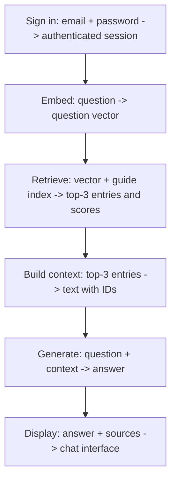

# Travel Assistant with RAG Chat


## Student information

| Field | Value |
|---|---|
| Full name | **Nguyễn Anh Quân** |
| Student ID | **25127123** |
| Chosen city | Ho Chi Minh City, Vietnam |
| Demonstration video | [Link](https://youtu.be/k4U7tv46oe0) |
| Repo link | [Repo](https://github.com/nguyenquan1203/CT-LAB-RAG_CHAT.git)| 

## Installation and configuration

Requirements: Python 3.11 or later.

Create and activate a virtual environment from the project root (Windows PowerShell):

```powershell
python -m venv .venv
.\.venv\Scripts\Activate.ps1
python -m pip install -r requirements.txt
```


Edit the local configuration with your own values:

```dotenv
FIREBASE_API_KEY=<your Firebase Web API Key>
OLLAMA_BASE_URL=<the current HTTPS URL from Pinggy>
```

## Run the app

```powershell
python -m streamlit run app.py
```


### Ollama + Pinggy on Google Colab

Use the instructor's server notebook from class:

1. Open it in Colab.
2. Run its Ollama installation and server startup cells.
3. Download both models: `embeddinggemma` and `qwen3:4b`.
4. Check that both the embedding and chat API tests succeed.
5. Open the notebook's terminal and run the class tunnel command:

   ```bash
   ssh -p 443 -R0:localhost:11434 -t qr@free.pinggy.io "u:Host:localhost:11434"
   ```

6. Copy the generated **HTTPS URL** into `OLLAMA_BASE_URL`, then start the app.


## Project files

| File | Responsibility |
|---|---|
| [app.py](./app.py) | Authentication gate, chat interface, session history, cache and source display |
| [firebase_client.py](./firebase_client.py) | Firebase email/password REST requests |
| [rag.py](./rag.py) | Embedding, cosine retrieval, context construction and generation |
| [config.py](./config.py) | Environment settings, model names, top-k and data path |
| [knowledge_base.json](./knowledge_base.json) | The 12-entry travel guide |
| [evaluate.py](./evaluate.py) | Six required questions plus one multi-entry retrieval-limit test |
| [test_app.py](./test_app.py) | Offline regression tests with mocked service responses |
| [VIDEO_SCRIPT.md](./VIDEO_SCRIPT.md) | Vietnamese script and recording guide, with English questions to paste into the app |

## Travel guide and sources

The guide is an AI-assisted English draft, paraphrased from the sources below.
Review the facts and revise the wording in your own words before submission.
IDs remain stable so test expectations and citations refer to the same entries.
Place categories and tags are included for the next RAG-Rec assignment.

Sources consulted on November 15, 2026:

- [Vietnam Tourism: Ho Chi Minh City](https://vietnam.travel/place-to-go/southeastern-vietnam/ho-chi-minh-city/)
- [Vietnam Tourism: 7 must-see attractions in HCMC](https://vietnam.travel/things-to-do/7-must-see-attractions-hcmc/)
- [Vietnam Tourism: The perfect weekend in HCMC](https://vietnam.travel/things-to-do/ho-chi-minh-city-itinerary/)
- [Independence Palace official website](https://dinhdoclap.gov.vn/)
- [Department of Cultural Heritage: Cu Chi Tunnels](https://dsvh.gov.vn/di-tich-lich-su-dia-dao-cu-chi-1490)

The app reads the stored guide, not the linked websites during chat. The current
guide does not include admission fees, opening hours or live weather forecasts.

## Test table required by the assignment

**Live evaluation on November 16, 2026: 6 passed and 1 failed out of 7 questions.**
The first six questions cover the required 3 answerable, 1 paraphrase and 2
outside-the-guide cases; all six passed. Question 7 is an additional multi-entry
test that exposed a retrieval limit. Each final answer was compared with the guide.

| Type | Question | Expected entry ID | Retrieved IDs | Correct? | Failure stage if incorrect |
|---|---|---|---|---|---|
| Answerable | Where is the Saigon Central Post Office? | G03 | G03, G04, G07 | Yes | None |
| Answerable | Where does Nguyen Hue Walking Street run from and to? | G06 | G06, G07, G08 | Yes | None |
| Answerable | Which months are usually the dry season in Ho Chi Minh City? | G12 | G12, G11, G08 | Yes | None |
| Paraphrase | What is the street address of the post office opposite Notre Dame Cathedral? | G03 | G03, G04, G06 | Yes | None |
| Outside the guide | How much is admission to the War Remnants Museum? | None: the fee is absent | G02, G01, G07 | Yes: correct refusal | None |
| Outside the guide | Will it rain in Ho Chi Minh City tomorrow? | None: no forecast is stored | G12, G11, G02 | Yes: correct refusal | None |
| Multi-entry limit | Give the addresses of Independence Palace, the Saigon Central Post Office and the War Remnants Museum, and the usual dry-season months in Ho Chi Minh City. | G01, G02, G03, G12 | G01, G03, G02 | No: dry-season information omitted | Retrieval: G12 missing from top-3 |

| Question | Recorded top-3 cosine scores |
|---|---|
| Post office address | G03=0.7878, G04=0.5919, G07=0.5347 |
| Walking street endpoints | G06=0.7539, G07=0.4942, G08=0.4294 |
| Dry-season months | G12=0.8364, G11=0.4264, G08=0.3938 |
| Paraphrased post office address | G03=0.6107, G04=0.5574, G06=0.3597 |
| Museum admission fee | G02=0.5219, G01=0.2965, G07=0.2451 |
| Tomorrow's weather | G12=0.6716, G11=0.4185, G02=0.3977 |
| Multi-entry query | G01=0.5966, G03=0.5464, G02=0.5427 |

For the first six cases, the expected entry ranked first for all four
answerable/paraphrase questions. These four answers were supported and the two
unsupported requests were correctly refused. The additional seventh case failed
to answer every requested part. Offline test passes remain separate from these live results.

### Observed final answers

| Question | Actual final answer |
|---|---|
| 1 | The Saigon Central Post Office is at 2 Cong Xa Paris [G03]. |
| 2 | Nguyen Hue Walking Street runs from the City Hall area to Bach Dang Wharf. [G06] |
| 3 | The dry season in Ho Chi Minh City usually spans December through April [G12]. |
| 4 | The street address of the post office opposite Notre Dame Cathedral is 2 Cong Xa Paris [G03]. |
| 5 | I don't know. This information is not in the travel guide. |
| 6 | I don't know. This information is not in the travel guide. |
| 7 | Independence Palace is at 135 Nam Ky Khoi Nghia [G01]. Saigon Central Post Office is at 2 Cong Xa Paris [G03]. War Remnants Museum is at 28 Vo Van Tan [G02]. The usual dry-season months in Ho Chi Minh City are not in the travel guide. |

### Question 7: failure analysis

The expected complete answer needs four entries: G01, G02 and G03 for the three
addresses, plus G12 for the usual dry-season months (December through April).
With `k = 3`, retrieval returned G01, G03 and G02, leaving G12 out of the context.

The actual response gave the three correct addresses but claimed the dry-season
months were unavailable. That information exists in G12, so the primary failure
is **retrieval**, not missing guide data. The answer is incomplete for this question.
Possible improvements are to split multi-part questions or evaluate a larger k.
The test was run with the existing guide and k unchanged.

Expected answers: G03 gives **2 Cong Xa Paris**; G06 runs from the **City Hall area
toward Bach Dang Wharf**; G12 gives **December through April** for the usual dry season.
The two outside-the-guide questions should receive the fixed "I don't know" response.
A correct refusal counts as success.

After configuring the server, run in a terminal with the virtual environment activated:

```powershell
python evaluate.py
```

The script creates `test_results.md` with actual answers, retrieved IDs and scores.
Manually assess each answer and update the table above. Classify a failed case as:

- **Missing data:** the guide does not contain a fact needed for the intended answer.
- **Retrieval:** the guide contains the answer, but top-k misses required entries.
- **Generation:** the retrieved context is sufficient, but the answer is incorrect
  or includes unsupported facts.

Valid citation IDs alone do not establish correctness. Retrieval always returns
top-3 entries, including for questions that have no answer in the guide.

### Offline regression tests

Use the same activated virtual environment:

```powershell
python -m unittest discover -s . -p test_app.py -v
```

These tests use mocked responses to check authentication boundaries, session
clearing, index caching, cosine ranking, citation validation and error handling.
They do not measure real model quality. Also manually try wrong credentials,
a whitespace-only question and an unavailable server.

#### Recorded offline test results

The following results are based on the console output supplied by the student
for the run starting at **2026-11-16 19:22:14**.

| Metric | Recorded result |
|---|---|
| Test suite | [test_app.py](./test_app.py) |
| Tests run | 16 |
| Passed | 16 |
| Failures / errors | 0 / 0 |
| Execution time | 0.535 seconds |
| Final status | `OK` |
| External services | Firebase and Ollama responses mocked; no live service verification |

| ID | Area | Scenario and expected behavior | Result |
|---|---|---|---|
| UT01 | Application | Expired authentication clears the previous conversation and hides chat. | PASS |
| UT02 | Application | Chat is unavailable before sign-in; two chat turns reuse one cached index; sign-out clears user details and history. | PASS |
| UT03 | Application | Stored assistant thinking is removed from history without changing the user's message. | PASS |
| UT04 | Firebase | A successful mocked sign-in retains only UID, email and expiry, without passwords or tokens. | PASS |
| UT05 | Firebase | Incorrect credentials raise a safe authentication error instead of creating a session. | PASS |
| UT06 | Retrieval | Cosine similarity ranks entries by direction rather than raw vector length. | PASS |
| UT07 | Input validation | A whitespace-only question is rejected before contacting the embedding server. | PASS |
| UT08 | Generation | The exact missing-information response is preserved. | PASS |
| UT09 | Output filtering | Thinking blocks, orphan closing tags and separate thinking output do not appear in the final answer or affect citation checks. | PASS |
| UT10 | Generation request | The request uses qwen3:4b, English instructions, an explicit thinking flag, the configured token cap and only retrieved guide text. | PASS |
| UT11 | Guide validation | Duplicate guide IDs are rejected before embedding. | PASS |
| UT12 | Error handling | A simulated network failure produces an actionable error without exposing raw connection details. | PASS |
| UT13 | Output validation | Token-limited responses are rejected, whether they contain partial text or no final text. | PASS |
| UT14 | Output filtering | An unfinished thinking block is rejected instead of being shown as an answer. | PASS |
| UT15 | Citation validation | Missing citations or IDs outside the retrieved entries produce the fixed refusal. | PASS |
| UT16 | Embedding validation | Zero-valued embedding vectors are rejected. | PASS |

**Warnings observed:** Streamlit printed `missing ScriptRunContext` warnings
while the offline test harness initialized simulated app sessions. These warnings
did not fail this run: the suite finished with `Ran 16 tests` and `OK`.
For normal interactive use, start the app with `python -m streamlit run app.py`.

This result verifies the covered application logic under mocked conditions.
It does not supply actual top-k IDs, similarity scores or answer correctness
for the six required live questions. Run `python evaluate.py` and review its
report to update the live table when testing again.

## Computational Thinking analysis

### Abstraction

Inputs are email/password for authentication and a travel question. Outputs are
an English answer, supporting entry IDs, retrieved entries and similarity scores.
Keep `id` for citations, `title/text` for retrieval and answering, `source` for
verification, and `category/tags` for future recommendations.
Booking, maps, live updates and preference profiles are outside this version.

### Decomposition



The public guide index is cached separately from each user's session history.

### Pattern recognition

Reuse the authentication/rerun pattern from Lab 3 and the embed -> cosine -> top-k
-> context -> generate pattern from the class RAG notebook. This version validates
the guide and scores all entries; it does not filter entries by category.
The broader **filter -> score -> top-k** pattern can be used in RAG-Rec by filtering
on category/tags before scoring and selecting places.

### Algorithm design

```text
If not signed in: show only the authentication form.
If the question is empty: show an error.
Get the cached guide index; rebuild when guide content or server URL changes.
Embed the question with embeddinggemma.
Calculate cosine similarity against every guide vector.
Select the three highest-scoring entries.
Build context containing their IDs and text.
Call qwen3:4b with the question, context and evidence-only instructions.
If the model reports missing information: keep the fixed refusal.
If citations are missing or refer outside the context: use the fixed refusal.
Display the answer, retrieved entries and scores.
Keep the turn in session state; clear the session at sign-out.
```

**Design decision:** start with `k = 3` to keep context short for a 12-entry guide.
This value has not been shown optimal by live evaluation. G02 describes the War
Remnants Museum but contains no admission fee, so retrieving G02 does not justify
inventing a price. A high similarity score does not establish answerability.

## Known limitations

- Answers are requested in at most three short sentences and 80 words, with a
  4,096-token generation budget and an 8,192-token context window. The generation
  budget includes the model's internal reasoning, not just its final answer.
  Responses that still reach the cap are rejected as incomplete.
- Only 12 entries are available; prices, opening hours and forecasts are absent.
- Prompt instructions and citation checks reduce unsupported answers but cannot
  prove that every cited claim is correct.
- Questions are processed independently, so follow-ups such as "What about there?"
  may lack the necessary context.
- Top-3 may omit required evidence for questions spanning more than three entries.
- History is session-only. Sign-out or session loss removes it.
- Expired authentication requires signing in again; refresh tokens are not retained.
- Colab/Pinggy can be slow, disconnect or change the public URL.

# AI Tools Used:
AI coding assistance was utilized for Streamlit syntax reference and prompt template drafting. Core architectural design, algorithmic pipeline, and test verification were independently validat
